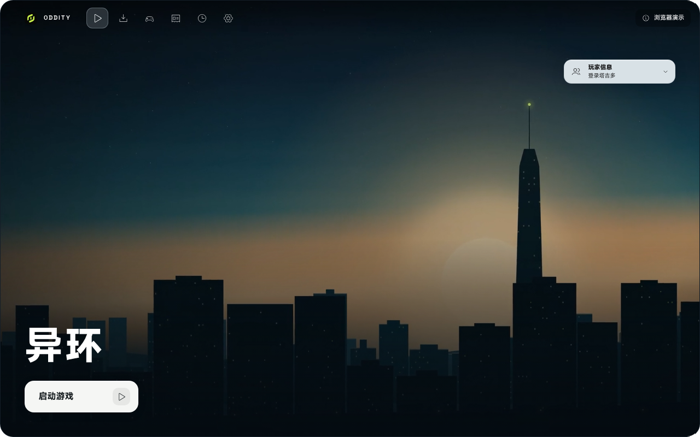
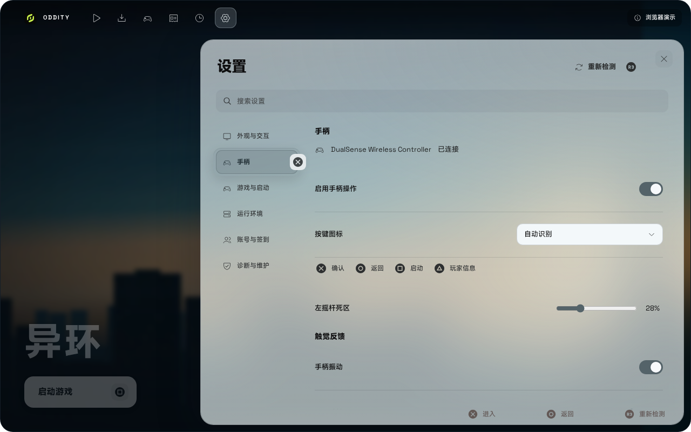

# 浏览器演示

浏览器演示在浏览器中展示 Oddity 的界面与主要交互流程, 使用示例数据, 不需要安装 Electron 或游戏资源.

在线体验: [lat-sky.github.io/Oddity](https://lat-sky.github.io/Oddity/)



## 可体验内容

- 主页主视觉、导航栏与各二级页面.
- 公告、更新流程与游玩记录.
- 设置、手柄支持与游戏模式界面.
- 连接 USB 或蓝牙手柄后, 可使用与桌面端一致的按键导航与按键提示.



演示站会随 `launcher/ui` 的界面改动自动更新.

## 限制

- 所有数据均为示例数据, 不代表真实账号或游戏状态.
- 安装、下载、系统能力检测、日志导出和账号登录等系统功能不可用, 或仅模拟交互结果.
- 浏览器无法提供扳机振动与自适应扳机, 振动效果也取决于浏览器与手柄支持情况.
- 关闭窗口、托盘和开机自启等桌面行为不存在.
- 演示不写入真实配置、凭据或游戏目录.

## 本地构建与预览

以下命令在 `launcher/ui` 下执行:

```bash
pnpm install --frozen-lockfile
pnpm run build:demo
pnpm run preview --port 4175 --base=/oddity-demo/
```

然后访问 [http://127.0.0.1:4175/oddity-demo/](http://127.0.0.1:4175/oddity-demo/).

`build:demo` 等价于 `pnpm run check && VITE_DEMO=1 vite build`, 构建产物位于 `launcher/ui/dist`. 构建完成后也可以运行冒烟测试, 它会在 `/oddity-demo/` 子路径下验证页面:

```bash
pnpm run test:demo
```

## 部署

推送到 `main` 且改动涉及 `launcher/ui` 时, [浏览器演示工作流](../.github/workflows/pages.yml) 会自动构建并部署到 GitHub Pages. 也可以在 Actions 页面手动运行“浏览器演示”工作流.

首次启用时, 在仓库 Settings → Pages 的 Source 中选择 "GitHub Actions". 构建使用相对 base, 演示站位于项目子路径 `/Oddity/`, 无需额外配置仓库名.

## 维护

界面改动合并到 `main` 后会自动出现在演示站, 无需单独更新.

示例数据主要在 `launcher/ui/src/core/api.ts` 与 `launcher/ui/src/core/demo.ts`, 新增界面需要补充示例数据时修改这两个文件.
