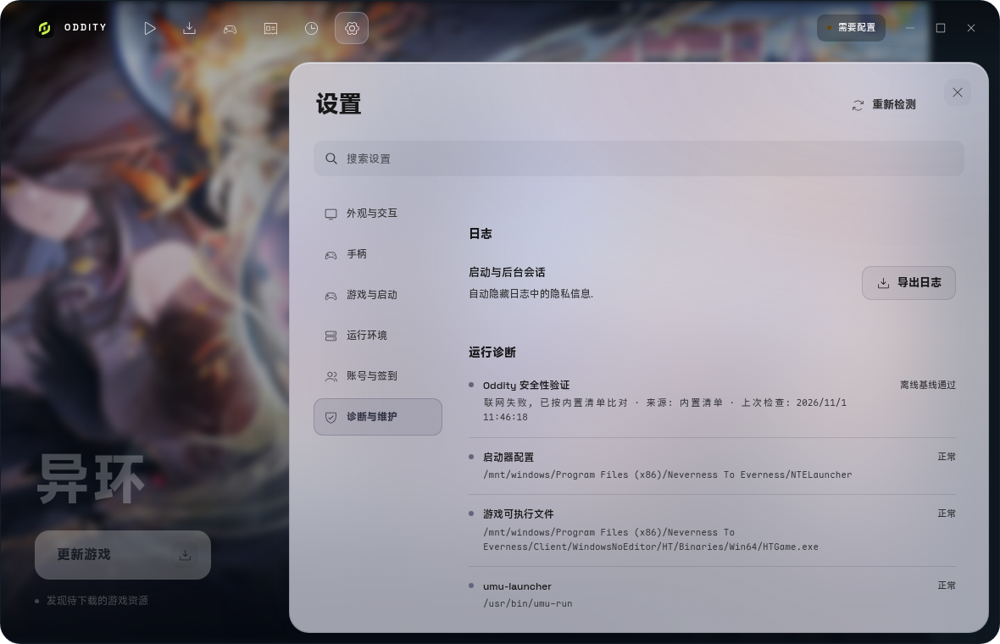

# 启动器安全验证

Oddity 每次启动时会在后台核对自身应用文件, 结果显示在 **设置 → 诊断与维护 → 运行诊断** 的 **Oddity 安全性验证**. 验证只读, 不拦截启动, 也不会自动修改文件.

> 实际运行截图, 状态以本机网络和安装方式为准.

## 校验对象

| 安装方式 | 核对内容 |
| --- | --- |
| AppImage | 整个 AppImage 文件, 与当前版本 Release 的 `SHA256SUMS` 比对 |
| deb / rpm / `.pkg.tar.zst` / 便携 tar.gz / AUR / Gentoo | 应用目录内的文件, 与 Release 的 `FILES.sha256` 比对 |
| Nix | 从源码构建, 文件与官方产物不同, 显示 **当前安装方式不支持校验** |

清单同时记录符号链接目标的摘要. 安装目录中出现未登记文件, 或符号链接指向应用目录外, 也会记为 **已修改**; AppImage 运行时追加的 `AppRun`、图标链接和 `usr` 目录不在此列.

联网时使用当前版本 tag 的 Release 资产直链 (`FILES.sha256` 或 `SHA256SUMS`). 信任链是 GitHub 的 TLS 和不可变 Release, 应用内不使用 sigstore 或内置公钥验签.

联网失败时, 对于随官方产物发布的安装方式, Oddity 会改用安装包内随应用发布的同一份 `FILES.sha256` 作为离线基线. 这能发现本地文件被改动, 也能避免断网绕过检查, 但不能证明启动器本身没有被替换.

## 状态说明

| 状态 | 含义 |
| --- | --- |
| 在线已验证 | 已从当前版本 Release 取得官方清单并比对通过 |
| 离线基线通过 | 联网失败, 安装包内的清单比对通过 |
| 未验证 | 联网失败, 且没有可用的本地清单 |
| 已修改 | 本地文件, 符号链接或未登记文件与清单不一致; 只有官方清单确认时才弹出重装引导 |
| 当前安装方式不支持校验 | Nix 等源码构建, 或运行在未打包的开发环境 |

每次检查完成时间保存在 `~/.local/share/oddity/integrity.json`, 只用于显示上次检查时间和判断提示是否已经展示过; 不写入 `settings.json`.

## 提示与限制

- 状态从 **未验证** 或 **已修改** 变为 **在线已验证** 时, 提示一次验证成功; 离线基线通过不弹成功提示.
- 每个应用版本第一次由官方清单确认文件不一致时, 弹出一次重装引导. 选择 **稍后处理** 后, 该版本不再反复弹窗, 运行诊断中的状态仍保持为 **已修改**. 联网失败时只用内置清单比对, 不会弹出重装引导.
- 验证失败不会阻止启动. 启动器内的检查防不住已经被替换的启动器本身, 目的是让用户尽快从官方来源重装, 而不是把启动器当成安全边界.
- AppImage 模式按运行环境提供的 `APPIMAGE` 路径判断正在运行的镜像; 如果启动环境被控制, 该路径和检查结果都不再可信.
- 断网时 AppImage 只能核对镜像内的应用目录, 不会重新计算整个镜像文件的摘要.
- 本检查不能替代安装前的安装包验证. 下载和验证方法见[安装指南](install.md#验证安装包).

## 引导重装

运行诊断显示 **已修改** 时, 请从 [Releases](https://github.com/LaT-SKY/Oddity/releases) 下载当前版本对应的官方安装包, 不要从第三方来源单独替换文件.

| 安装方式 | 重新安装 |
| --- | --- |
| Debian / Ubuntu | `pkexec apt install --reinstall ./oddity_*_amd64.deb` |
| Fedora | `pkexec dnf reinstall ./oddity-*.x86_64.rpm` |
| openSUSE | `pkexec zypper install --force ./oddity-*.x86_64.rpm` |
| Arch Linux / AUR | 重新安装发行包: `pkexec pacman -U ./oddity-bin-*.pkg.tar.zst`, 或通过 AUR 重新构建 |
| AppImage | 退出 Oddity 后删除或覆盖旧文件, 再执行 `chmod +x oddity-*.AppImage` |
| 便携 tar.gz | 解压新的官方 tarball, 覆盖原应用目录后重新启动 |
| Gentoo | 重新安装 `oddity-bin` 软件包 |
| Nix | 用 Nix 配置重新安装; 源码构建不参与官方清单校验 |

从源码运行时不经过发布流程, 不生成官方清单, 状态会显示为不支持校验.
